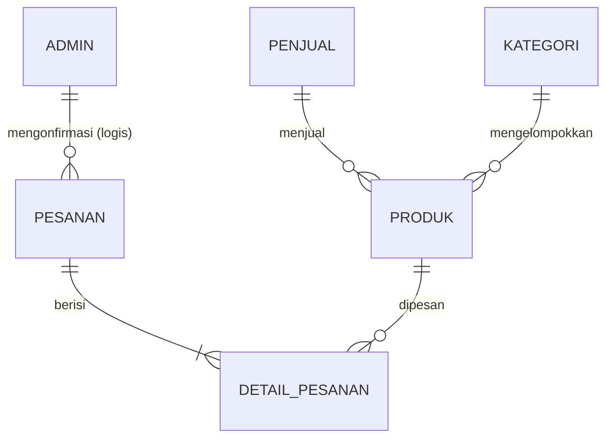

# 🧸 Toko Mungil – Marketplace Tradisional (PHP Native + MySQLi + Bootstrap)

## A. Analisis & Perancangan
**Entitas (6):** admin, penjual, kategori, produk, pesanan, detail_pesanan.

| Tabel | Atribut (PK **bold**, FK *italic*) |
|---|---|
| admin | **id_admin**, username, password |
| penjual | **id_penjual**, nama_toko, kontak |
| kategori | **id_kategori**, nama_kategori |
| produk | **id_produk**, *id_penjual*, *id_kategori*, nama, deskripsi, harga, stok, emoji, gambar |
| pesanan | **id_pesanan**, kode, nama_pembeli, no_hp, alamat, total, status, tanggal |
| detail_pesanan | **id_detail**, *id_pesanan*, *id_produk*, jumlah, harga |

**Relasi:** penjual 1—N produk · kategori 1—N produk · pesanan 1—N detail_pesanan · produk 1—N detail_pesanan (pesanan M—N produk).

## ERD

(Tempel kode di https://mermaid.live untuk export PNG.)

## Alur Transaksi
Pembeli buka Beranda → pilih produk → Detail → Tambah ke Keranjang → atur jumlah → isi nama/HP/alamat → Checkout → pesanan tersimpan (status *Menunggu Konfirmasi*) + kode pesanan → pembeli cek di menu **Status Pesanan** → Admin login → **Kelola Pesanan** → Konfirmasi/Tolak → Dikemas → Dikirim → Selesai. Stok berkurang saat dikonfirmasi, kembali jika dibatalkan.

## Mockup UI (wireframe)
- **Daftar produk:** navbar · hero + pencarian · chip kategori · grid kartu (gambar, toko, nama, harga, Detail, +🛒)
- **Detail produk:** gambar besar kiri · kanan: kategori, toko, nama, harga, deskripsi, stok, qty + tombol keranjang
- **Keranjang:** kiri daftar item (qty, hapus) · kanan form pemesan + total + Checkout

## B. Instalasi (otomatis)
1. Letakkan semua file di folder web (XAMPP: `C:\xampp\htdocs\mp\`, InfinityFree: `htdocs/`).
2. Buka `http://localhost/mp/` (atau URL hosting). Kamu otomatis diarahkan ke **install.php**.
3. Isi host, username, password, nama database → klik **Pasang Sekarang**. Tabel + data contoh dibuat sendiri.
4. **Hapus install.php** dari server. Login admin: `/admin/login.php` → **admin / admin123** (ganti setelah deploy).

Data InfinityFree: Control Panel → MySQL Databases (host `sqlXXX.infinityfree.com`, user & DB berawalan `if0_`; buat database dulu, lalu hilangkan centang "buatkan database otomatis").

## C. Deploy & GitHub
Upload semua isi folder ke `htdocs/` (File Manager/FTP), folder `uploads/` harus bisa ditulis.
`git init && git add . && git commit -m "marketplace" && git remote add origin <URL> && git push -u origin main` — `koneksi.local.php` (berisi password) otomatis diabaikan oleh .gitignore.

**URL demo:** _isi_ · **URL GitHub:** _isi_
